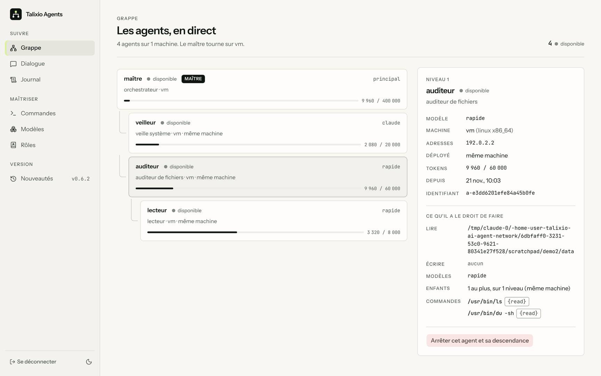
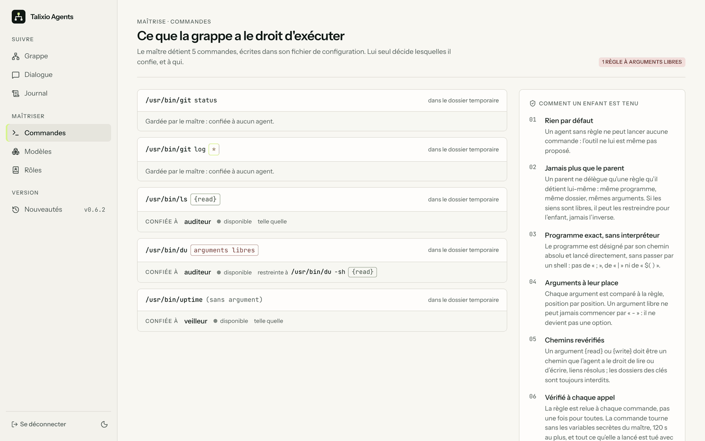

# Talixio Agent Network

Des agents IA autonomes, en grappe. Chaque agent est un petit process Rust avec un modèle, des
instructions et des droits limités. Un agent peut créer des enfants et leur confier des missions ;
un enfant ne parle qu'à son parent et n'a jamais plus de droits que lui.

- Spécification : [docs/SPEC.md](docs/SPEC.md)
- Planning et avancement : [docs/PLAN.md](docs/PLAN.md)

## Compiler

```bash
cargo build --release
```

L'exécutable est `target/release/talixio-agent`. C'est tout ce qu'il faut déployer, avec un fichier de configuration.

### Exécutable statique (recommandé pour déployer)

Compilé ainsi, l'exécutable ne dépend d'aucune bibliothèque du système : il tourne tel quel sur
n'importe quelle distribution Linux du même processeur, et dans n'importe quelle image Docker,
même vide. C'est la version à utiliser dès que le maître déploie des agents ailleurs.

```bash
sudo apt-get install -y musl-tools
```

```bash
rustup target add x86_64-unknown-linux-musl
```

```bash
cargo build --release --target x86_64-unknown-linux-musl
```

L'exécutable est alors `target/x86_64-unknown-linux-musl/release/talixio-agent` (5,3 Mo).

## Lancer le maître

```bash
cp talixio.example.toml talixio.toml
```

```bash
ANTHROPIC_API_KEY=... target/release/talixio-agent root --config talixio.toml
```

## Piloter

### Dans un navigateur

Ouvrir l'adresse du maître (`https://127.0.0.1:7700/` par défaut) et saisir le jeton de l'API
(`.talixio/api-token`). Sur un téléphone, la page s'installe comme une application.



L'écran « Commandes » montre ce que le maître a le droit d'exécuter et à qui il l'a confié ;
« Rôles » montre les agents créés.



« Fournisseurs » liste tous les fournisseurs du catalogue embarqué (`catalog.toml`) : pays,
Europe ou non, niveau de confiance, connecté ou non. « Modèles » liste leurs modèles avec leur
qualité et leur prix indicatif, et dit lesquels sont activés chez le maître.


### Voix, image, prévision, décision

Un agent peut aussi transcrire un son, lire un texte à voix haute, créer ou décrire une image,
chercher dans sa mémoire par le sens, prévoir la suite d'une série ou poser des questions fermées
à un modèle de décision. Ces modèles se déclarent chez le maître avec leur `nature`, et se
comptent en appels :

```toml
[models.oreille]
provider = "openai"
nature = "transcription"
base_url = "https://api.mistral.ai/v1"
model = "voxtral-mini-latest"
api_key_file = "/etc/talixio/mistral.key"

[capabilities.max_calls]
transcription = 200
```

Comme pour le texte, la clé reste chez le maître et un enfant n'obtient un modèle de service et
un nombre d'appels que si son parent les lui confie, dans la limite des siens. Sans ligne dans
`max_calls`, aucun appel n'est permis. Toutes les natures et leurs fournisseurs :
`talixio.example.toml`.

L'interface (`web/`) est faite avec React et shadcn/ui. Son résultat construit, `web/dist/`, est
au dépôt : `cargo build` suffit. Pour la modifier :

```bash
cd web && npm ci && npm run build
```

### En ligne de commande

Depuis le dossier du maître (le jeton de l'API et l'empreinte de son certificat sont lus dans `.talixio/`) :

```bash
talixio-agent send "Audite le dossier /srv/projet et dis-moi ce qui cloche."
```

```bash
talixio-agent watch
```

```bash
talixio-agent tree
```

```bash
talixio-agent stop <identifiant>
```

Ce qui a changé de version en version :

```bash
talixio-agent releases
```

L'API JSON est décrite dans la spécification.

## Tester

```bash
cargo test
```

## Limites actuelles

- Déploiement par SSH et dans Docker (`[targets]`, voir `talixio.example.toml`) : écrit et testé avec des
  programmes factices, pas encore essayé sur une vraie machine. La cible doit avoir le même processeur que
  le maître ; avec l'exécutable statique, la distribution n'a plus d'importance.
- Le cloisonnement est fait par le process lui-même, pas encore par le système d'exploitation :
  une commande autorisée s'exécute avec tous les droits du compte. N'autoriser que des commandes
  inoffensives, et lancer le maître sous un compte dédié sans privilèges (voir la spécification, §7).
- Les modèles de service (voix, image, prévision, décision…) n'ont été essayés qu'avec de faux fournisseurs : le premier
  essai chez un vrai fournisseur peut demander un ajustement.
- Testé en intégration continue sous Linux, macOS et Windows ; pas encore essayé sur un poste Windows ou macOS réel, ni avec un vrai `ssh` ou un vrai Docker.
