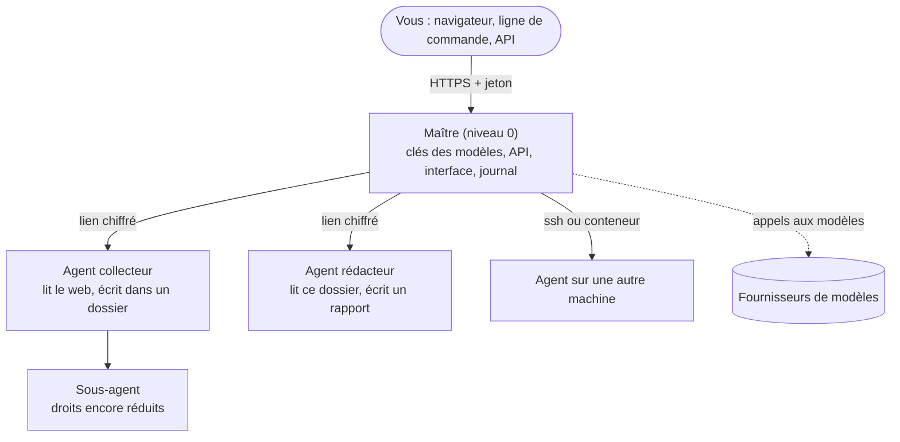
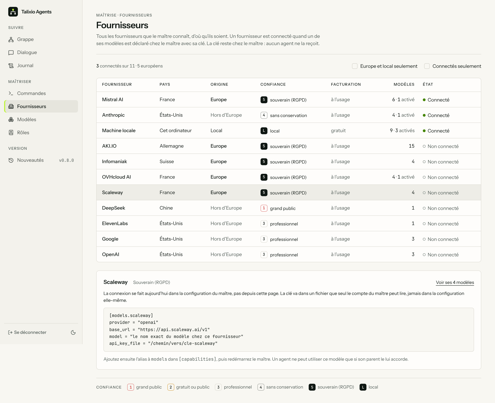

# Talixio Agent Network

[](https://github.com/fredolier/talixio-ai-agent-network/actions/workflows/ci.yml)
[](LICENSE)

**Des agents IA autonomes qui travaillent en équipe, sans jamais avoir plus de droits que ce que
vous leur avez donné.**

Un agent « maître » reçoit votre demande, crée d'autres agents, leur confie des missions et vous
rend compte. Chaque agent est un petit process avec un modèle, des consignes et des droits
limités. Tout est dans un seul exécutable Rust, `talixio-agent`, que l'on pose sur une machine,
dans un conteneur ou derrière un `ssh`.


> **État du projet : jeune.** Le cœur fonctionne et il est testé sous Linux, macOS et Windows à
> chaque changement, mais plusieurs modes n'ont pas encore servi en conditions réelles. Lisez
> [« Limites actuelles »](#limites-actuelles) avant de lui confier quoi que ce soit d'important.

*In English: Talixio Agent Network runs autonomous AI agents as a tree of small, least-privilege
processes. A root agent spawns children, hands them missions with measurable success criteria,
and reports back. Everything is denied by default, a child never holds more rights than its
parent, model keys stay with the root agent, and every tool call is checked again. One static
Rust binary; web UI, CLI and JSON API included. The documentation is in French for now.*

## Pourquoi

Un agent IA qui agit sur une machine pose toujours la même question : que peut-il faire au
juste, et qui l'a décidé ? La plupart des outils répondent par la confiance dans le modèle. Ici
la réponse est dans le programme :

- **Tout est refusé par défaut.** Un agent ne lit, n'écrit et ne lance que ce qui est écrit dans
  ses droits : des dossiers, des commandes avec leurs arguments permis, des modèles, un budget.
- **Un enfant n'a jamais plus de droits que son parent.** Les droits ne font que se réduire en
  descendant l'arbre, et chaque appel d'outil est revérifié par le programme, quoi que le
  modèle demande.
- **Les clés des modèles restent chez le maître.** Les autres agents passent par lui : aucun
  n'a de clé à voler, et chacun est compté (tokens, appels).
- **Le maître ne se donne pas de pouvoirs.** Ses commandes et ses rôles viennent de paquets que
  vous installez vous-même, vérifiés par empreinte à chaque démarrage et à chaque lancement.
- **Tout se voit.** L'arbre des agents, leurs droits, leurs échanges et leurs dépenses sont dans
  l'interface et dans un journal.

## Comment ça marche



1. **Vous parlez au maître**, dans l'interface web, en ligne de commande ou par l'API.
2. **Le maître décide de déléguer** : il crée un agent avec un rôle, une mission, un critère de
   réussite mesurable, un modèle, un budget et des droits pris dans les siens.
3. **L'agent travaille seul** avec ses outils (lire, écrire, lancer une commande permise, créer
   ses propres enfants s'il en a le droit) et ne parle qu'à son parent.
4. **Il rend compte** : mission réussie ou non, avec la preuve. Le parent vérifie, relance,
   arrête, ou conclut à son tour.
5. **Vous suivez et vous arrêtez** ce que vous voulez, à tout moment.

Un agent peut tourner sur la machine du maître, dans un conteneur Docker (lecture seule, sans
capacité, sans réseau si vous le voulez) ou sur une autre machine par `ssh`. Les modèles viennent
d'un catalogue de fournisseurs embarqué (Anthropic, OpenAI, Mistral, OVHcloud, Scaleway, Gemini,
OpenRouter… avec leur pays et leur niveau de confiance), ou de votre abonnement Claude par la
commande officielle `claude`.

## À quoi ça sert

Quelques usages visés ; les deux premiers ont été essayés, les autres sont ce pour quoi l'outil
est conçu.

- **Veille et tenue à jour d'un document.** Trois agents (collecteur, rédacteur, vérificateur)
  relèvent sur le web les modèles et les prix des fournisseurs et proposent une mise à jour du
  catalogue : c'est l'exemple fourni, [`examples/catalogue`](examples/catalogue).
- **Lire le web avec un vrai navigateur**, dans un conteneur à part, sur une liste de sites
  permise.
- **Audit puis correction, séparés.** Un agent diagnostique une machine en lecture seule et rend
  compte ; son parent décide ensuite d'envoyer un agent correcteur, avec d'autres droits.
- **Tâches planifiées.** Une mission relancée chaque jour ou chaque semaine (page « Tâches »).
- **Agents permanents.** Un agent qui revient avec sa mémoire à chaque redémarrage du maître.
- **Équipe pour une mission longue**, où chaque agent a un modèle à sa mesure : un petit modèle
  pour collecter, un grand pour vérifier.

Ce que ce n'est pas : un assistant personnel (voir
[Talixio AI Assistant](https://github.com/fredolier/talixio-ai-assistant)), ni un bac à sable
complet. Le cloisonnement entre agents d'un même compte est fait par le programme, pas encore
par le système : voir les limites.

## Démarrer en cinq minutes

Avec Docker, sans rien installer d'autre et sans clé de modèle :

```bash
git clone https://github.com/fredolier/talixio-ai-agent-network && cd talixio-ai-agent-network
```

```bash
./tools.sh up
```

```bash
./tools.sh token
```

Ouvrez `https://127.0.0.1:7700` (le certificat est fabriqué par le maître : le navigateur demande
confirmation), entrez le jeton, connectez un fournisseur dans « Fournisseurs » (OVHcloud se
connecte sans clé, pour essayer), activez un modèle dans « Modèles », puis parlez au maître dans
« Dialogue ». La suite de cette page détaille chaque mode.

## Sommaire

- [Installer](#installer) · [Dans Docker](#dans-docker) · [Paquets : commandes et rôles](#paquets--commandes-et-rôles) · [En service](#en-service)
- [Compiler](#compiler) · [Lancer le maître](#lancer-le-maître) · [Piloter](#piloter) · [Tester](#tester)
- [Limites actuelles](#limites-actuelles) · [Documentation](#documentation) · [Contribuer](#contribuer) · [Sécurité](#sécurité) · [Licence](#licence)

## Installer

Un exécutable par système est publié à chaque version (Linux et macOS, x86_64 et ARM ; Windows
x86_64), avec ses empreintes. Une ligne suffit ; rien n'est lancé et rien ne demande root.

Linux et macOS :

```bash
curl -fsSL https://github.com/fredolier/talixio-ai-agent-network/releases/latest/download/install.sh | sh
```

Windows (PowerShell) :

```powershell
irm https://github.com/fredolier/talixio-ai-agent-network/releases/latest/download/install.ps1 | iex
```

Le script télécharge l'exécutable de la machine, vérifie son empreinte SHA-256 et le pose dans
`~/.local/bin` (Windows : `%LOCALAPPDATA%\Talixio`). `TALIXIO_VERSION=0.10.0` choisit une version,
`TALIXIO_INSTALL_DIR` un autre dossier. On peut aussi télécharger le fichier à la main depuis la
page des versions du dépôt. L'empreinte vient du même endroit que l'exécutable : elle protège
d'un téléchargement abîmé, pas d'un dépôt compromis.

## Dans Docker

Pour essayer sans rien installer et sans risque pour la machine : une image qui ne contient que
l'exécutable (6,5 Mo), sans système ni shell, où le maître tourne sous un compte sans droit.

Le plus court, depuis le dépôt : `./tools.sh up` construit l'image et lance le maître,
`./tools.sh token` affiche le jeton de l'interface (tiré au hasard, gardé hors du dépôt dans
`~/.config/talixio/`), `./tools.sh up claude` fait de même avec votre abonnement Claude (voir plus
bas), `./tools.sh logs`, `status` et `stop` font le reste. Les commandes qu'il lance sont celles
qui suivent, à la main :

```bash
docker build -t talixio-agent .
```

```bash
export TALIXIO_API_TOKEN="$(openssl rand -hex 32)"; echo "$TALIXIO_API_TOKEN"
```

```bash
docker run -d --name talixio -p 127.0.0.1:7700:7700 -v talixio-data:/data --cap-drop ALL --security-opt no-new-privileges --pids-limit 256 --memory 1g -e TALIXIO_API_TOKEN talixio-agent
```

La deuxième commande tire le jeton de l'interface au hasard et l'affiche : gardez-le. Un jeton
faible ou recopié d'un exemple est refusé. Aucune clé de modèle n'est demandée pour démarrer.

Puis ouvrez `https://127.0.0.1:7700` (le certificat est fabriqué par le maître : le navigateur
demande confirmation) et entrez votre jeton. Dans « Fournisseurs », connectez le vôtre ; dans
« Modèles », activez un modèle de texte : le premier activé devient celui du maître, et
« Donner au maître » en change. Les agents ne lisent et n'écrivent que dans `/data/work`, et
aucune commande ne leur est permise. Pour d'autres droits, montez votre configuration :
`-v /chemin/talixio.toml:/config/talixio.toml:ro` (modèle : `docker/talixio.toml`).

### Avec votre abonnement Claude

L'image ci-dessus est vide : elle ne peut pas héberger la commande `claude`. Une seconde image
l'ajoute, pour servir des modèles avec un abonnement Claude (Pro, Max) plutôt qu'une clé d'API :

```bash
docker build -f docker/Dockerfile.claude -t talixio-agent:claude .
```

```bash
docker run -d --name talixio -p 127.0.0.1:7700:7700 -v talixio-data:/data --cap-drop ALL --security-opt no-new-privileges --pids-limit 512 --memory 3g -e TALIXIO_API_TOKEN talixio-agent:claude
```

Puis connectez `claude` à votre abonnement, une fois (`./tools.sh login` fait la même chose) :

```bash
docker exec -it talixio claude auth login
```

`claude` affiche un lien : ouvrez-le, connectez-vous chez Anthropic, recollez le code. Il garde
sa connexion dans le volume (`/data/.claude`, interdit aux agents) : elle survit aux mises à jour
du conteneur. Autre voie, sans cette étape : tirer un jeton sur votre poste avec
`claude setup-token` et le passer au lancement (`-e CLAUDE_CODE_OAUTH_TOKEN`).

Dans « Fournisseurs », « Claude (abonnement) », « Connecter » ; puis activez Opus, Sonnet ou
Haiku dans « Modèles ». Le maître lance la commande `claude` telle quelle : il ne lit ni ne
garde votre jeton, et n'appelle pas l'API d'Anthropic lui-même. Les outils intégrés de `claude`
sont coupés : il n'a que ceux de l'agent, dont chaque appel repasse par les contrôles de droits.
L'usage compte dans les limites de votre abonnement, aux conditions d'Anthropic pour un usage
personnel ; elles ont changé plusieurs fois en 2026, vérifiez-les. Hors Docker, il suffit que
`claude` soit installé et connecté sous le compte du maître. « Anthropic » (clé d'API) reste
disponible à côté : les deux peuvent servir en même temps.

```bash
docker logs talixio
```

```bash
docker rm -f talixio
```

## Paquets : commandes et rôles

Un paquet donne au maître des commandes (des scripts, avec leurs arguments permis) et des rôles
(des consignes toutes faites pour un agent). C'est vous qui les installez ; le maître ne peut ni
s'en ajouter ni les modifier, et il vérifie leurs empreintes à chaque démarrage.

```bash
./tools.sh pack list
```

```bash
./tools.sh pack show catalogue
```

```bash
./tools.sh pack install catalogue
```

```bash
./tools.sh run claude
```

Hors de Docker : le plus simple est le compte dédié (voir « En service »), après quoi
`sudo talixio-agent pack install catalogue` suffit. À la main : `talixio-agent pack install
catalogue --dir /opt/talixio/packs` sous un autre compte que celui du maître, et
`packs_dir = "/opt/talixio/packs"` dans `talixio.toml`. Voir `examples/catalogue`.

Après une mise à jour du dépôt (`git pull`), reconstruisez l'image : `./tools.sh build claude`.
`tools.sh` s'arrête et le dit si l'image est plus ancienne que le dépôt.

Pour parcourir plutôt que taper : `./tools.sh pack tui` (ou `talixio-agent pack tui`). La liste
à gauche, ce que le paquet donnerait à droite ; `i` installe, `r` retire, `v` vérifie, `q` quitte.

### Dépôt de paquets

Des paquets peuvent venir d'un dépôt : un dossier de fichiers derrière https, dont l'index est
signé. Rien n'est lu sans la clé publique de son éditeur, et l'hébergeur ne peut rien y changer.

```bash
talixio-agent pack list --depot https://exemple.fr/paquets --key <clé publique>
```

```bash
sudo talixio-agent pack install <nom> --depot https://exemple.fr/paquets --key <clé publique>
```

Publier les vôtres (la clé privée reste chez vous, hors du serveur) :

```bash
talixio-agent pack keygen --out ma-cle
```

```bash
talixio-agent pack publish --from mes-paquets --out depot --key-file ma-cle
```

Le dossier `depot` se dépose tel quel sur un serveur de fichiers. Il n'y a pas encore de dépôt
officiel Talixio.

## En service

Pour que le maître reparte seul au démarrage de la machine et après une panne, depuis le dossier
où se trouve `talixio.toml` :

```bash
talixio-agent service install --config talixio.toml
```

Linux : unité systemd de votre compte. macOS : agent launchd. Windows : tâche planifiée à
l'ouverture de session. `--print` montre ce qui serait fait sans rien faire ; `service status` et
`service uninstall` font le reste. Un service n'hérite pas des variables de votre terminal :
donnez les clés par `api_key_file`, depuis l'interface, ou sous Linux par `--env-file`.

### Compte dédié (Linux, recommandé)

```bash
sudo talixio-agent service install --config talixio.toml
```

En root, la commande met tout en place pour que le maître ne puisse modifier ni son exécutable,
ni sa configuration, ni ses paquets :

| Quoi | Où | À qui |
|---|---|---|
| exécutable | `/opt/talixio/talixio-agent` | root |
| paquets (commandes, rôles) | `/opt/talixio/packs` | root |
| configuration | `/etc/talixio/talixio.toml` | root (lisible par le compte) |
| état, clés saisies dans l'interface, travail | `/var/lib/talixio` | `talixio-agent` |

Le compte `talixio-agent` est créé s'il manque, sans mot de passe ni shell. Ensuite :

```bash
sudo talixio-agent pack install catalogue
```

```bash
sudo systemctl restart talixio-agent
```

Modifier la configuration : `sudo` sur `/etc/talixio/talixio.toml`, puis redémarrer le service
(`talixio-agent check --config <fichier>` la vérifie sans rien lancer). Le jeton de l'interface :
`sudo cat /var/lib/talixio/.talixio/api-token`. Les chemins relatifs de la configuration partent
de `/var/lib/talixio`. Pour faire tourner le maître sous un compte à vous, là où sont ses
fichiers : `sudo talixio-agent service install --user <compte>` (jamais root).

Au redémarrage, le maître retrouve son journal, sa mémoire, ses fournisseurs, et ses agents
**permanents** : demandez-lui de créer un agent « permanent », il le recrée à chaque démarrage
avec sa mémoire, jusqu'à ce que vous l'arrêtiez. Les agents ordinaires ne reviennent pas.

## Compiler

```bash
cargo build --release
```

L'exécutable est `target/release/talixio-agent`. C'est tout ce qu'il faut déployer, avec un fichier de configuration.

### Exécutable statique (recommandé pour déployer)

Compilé ainsi, l'exécutable ne dépend d'aucune bibliothèque du système : il tourne tel quel sur
n'importe quelle distribution Linux du même processeur, et dans n'importe quelle image Docker,
même vide. C'est la version à utiliser dès que le maître déploie des agents ailleurs.

```bash
sudo apt-get install -y musl-tools
```

```bash
rustup target add x86_64-unknown-linux-musl
```

```bash
cargo build --release --target x86_64-unknown-linux-musl
```

L'exécutable est alors `target/x86_64-unknown-linux-musl/release/talixio-agent` (5,3 Mo).

## Lancer le maître

```bash
cp talixio.example.toml talixio.toml
```

```bash
ANTHROPIC_API_KEY=... target/release/talixio-agent root --config talixio.toml
```

## Piloter

### Dans un navigateur

Ouvrir l'adresse du maître (`https://127.0.0.1:7700/` par défaut) et saisir le jeton de l'API
(`.talixio/api-token`). Sur un téléphone, la page s'installe comme une application.


L'écran « Commandes » montre ce que le maître a le droit d'exécuter et à qui il l'a confié ;
« Rôles » montre les agents créés.


« Fournisseurs » liste tous les fournisseurs du catalogue embarqué (`catalog.toml`) : pays,
Europe ou non, niveau de confiance, connecté ou non. « Modèles » liste leurs modèles avec leur
qualité et leur prix indicatif, et dit lesquels sont activés chez le maître.

On se connecte depuis la page : dans « Fournisseurs », choisissez un fournisseur, collez votre clé
(un lien mène à la page où la créer), « Connecter ». Le maître essaie la clé, la range dans un
fichier que seul son compte peut lire (`<state_dir>/keys/`), et ne la rend plus jamais. Dans
« Modèles », « Activer » rend un modèle utilisable aussitôt, sans redémarrage. OpenRouter se
connecte par autorisation dans le navigateur ; OVHcloud se connecte aussi sans clé (« Connecter
sans clé » : anonyme, limites basses, de quoi essayer) ; les autres (OpenAI, Anthropic, Gemini, Mistral,
OVHcloud, AKI.IO, Scaleway, ElevenLabs, DeepSeek) par clé. Le maître lui-même reçoit son
modèle de la même façon : sans `model` dans `talixio.toml`, il démarre sans modèle ni clé, prend
le premier modèle de texte activé, et « Donner au maître » lui en donne un autre. Déclarer les
modèles dans `talixio.toml` reste possible ; un `model` écrit là ne se change pas depuis la page.



### Voix, image, prévision, décision

Un agent peut aussi transcrire un son, lire un texte à voix haute, créer ou décrire une image,
chercher dans sa mémoire par le sens, prévoir la suite d'une série ou poser des questions fermées
à un modèle de décision. Ces modèles se déclarent chez le maître avec leur `nature`, et se
comptent en appels :

```toml
[models.oreille]
provider = "openai"
nature = "transcription"
base_url = "https://api.mistral.ai/v1"
model = "voxtral-mini-latest"
api_key_file = "/etc/talixio/mistral.key"

[capabilities.max_calls]
transcription = 200
```

Comme pour le texte, la clé reste chez le maître et un enfant n'obtient un modèle de service et
un nombre d'appels que si son parent les lui confie, dans la limite des siens. Sans ligne dans
`max_calls`, aucun appel n'est permis. Toutes les natures et leurs fournisseurs :
`talixio.example.toml`.

L'interface (`web/`) est faite avec React et shadcn/ui. Son résultat construit, `web/dist/`, est
au dépôt : `cargo build` suffit. Pour la modifier :

```bash
cd web && npm ci && npm run build
```

### En ligne de commande

Depuis le dossier du maître (le jeton de l'API et l'empreinte de son certificat sont lus dans `.talixio/`) :

```bash
talixio-agent send "Audite le dossier /srv/projet et dis-moi ce qui cloche."
```

```bash
talixio-agent watch
```

```bash
talixio-agent tree
```

```bash
talixio-agent stop <identifiant>
```

Ce qui a changé de version en version :

```bash
talixio-agent releases
```

L'API JSON est décrite dans la spécification.

## Tester

```bash
cargo test
```

## Limites actuelles

- **Projet jeune, peu éprouvé hors de ses tests.** Les essais réels à ce jour : un maître dans
  Docker avec l'abonnement Claude et avec OVHcloud, l'exemple « catalogue » à trois agents, des
  agents lancés dans des conteneurs voisins. Le reste est couvert par des tests automatiques.
- **Le cloisonnement entre agents d'un même compte est fait par le programme, pas encore par le
  système d'exploitation** : une commande autorisée s'exécute avec tous les droits du compte.
  N'autorisez que des commandes écrites au plus serré, et faites tourner le maître sous le compte
  dédié ou dans un conteneur (voir la spécification, §7).
- **Pas encore essayé en conditions réelles** : le déploiement par `ssh` sur une vraie machine
  (testé avec un faux `ssh`) ; le service sous un vrai systemd, launchd ou Windows ; un poste
  Windows ou macOS réel (l'intégration continue y passe) ; un dépôt de paquets servi en https ;
  les modèles de service (voix, image, prévision, décision) chez un vrai fournisseur.
- **Une cible distante doit avoir le même processeur que le maître** ; avec l'exécutable
  statique, la distribution n'a plus d'importance.
- **Pas de dépôt officiel de paquets** pour l'instant : seuls ceux de l'exécutable, les vôtres,
  ou ceux d'un éditeur dont vous avez la clé publique.
- **Documentation en français** seulement.

## Documentation

| Document | Contenu |
|---|---|
| [docs/SPEC.md](docs/SPEC.md) | Exigences, décisions d'architecture (numérotées, datées, motivées), questions ouvertes, et le compte rendu de chaque revue de sécurité (§7). |
| [docs/PLAN.md](docs/PLAN.md) | Tâches, étape en cours, journal de ce qui a été fait. |
| [docs/EXIGENCES.md](docs/EXIGENCES.md) | Chaque demande, sa source, et l'état de ses critères. |
| [docs/VERIFICATION.md](docs/VERIFICATION.md) | Une vérification indépendante des exigences. |
| [talixio.example.toml](talixio.example.toml) | La configuration du maître, commentée. |
| [examples/catalogue](examples/catalogue) | Un exemple complet à trois agents. |
| `talixio-agent releases` | Les notes de version ([releases.toml](releases.toml)), aussi dans l'interface. |

## Contribuer

Les rapports de bogue, les questions et les propositions sont bienvenus : voir
[CONTRIBUTING.md](CONTRIBUTING.md). En bref : `cargo test` et `cargo clippy --all-targets` doivent
passer, la documentation suit le code dans le même changement, et toute nouvelle surface (outil,
route, mode de déploiement) passe par une revue de sécurité.

## Sécurité

Une faille ne se signale pas dans un ticket public : voir [SECURITY.md](SECURITY.md). Ce contre
quoi le projet se défend, ses limites connues et le détail des quinze revues de sécurité déjà
faites sont dans [docs/SPEC.md](docs/SPEC.md), §7.

## Licence

Copyright (C) 2026 Talixio. Ce programme est un logiciel libre : vous pouvez le redistribuer et le
modifier selon les termes de la GNU Affero General Public License, version 3 (`AGPL-3.0-only`),
dans [`LICENSE`](LICENSE). Il est fourni sans aucune garantie. Si vous faites tourner une version
modifiée pour d'autres personnes à travers un réseau, vous devez leur en offrir le code source.

L'interface embarque les polices Instrument Sans et JetBrains Mono, sous licence SIL Open Font
License 1.1. Les bibliothèques Rust et JavaScript employées gardent leurs propres licences
(MIT, Apache-2.0, BSD, ISC pour l'essentiel), listées dans `Cargo.lock` et `web/package-lock.json`.
