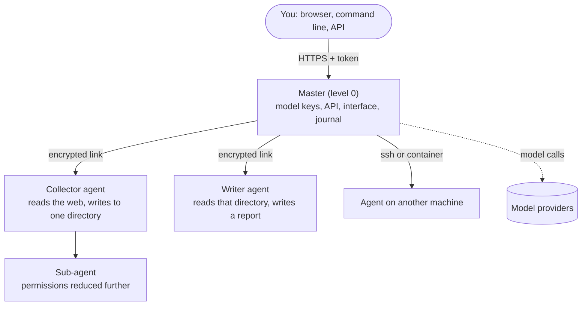

# Talixio Agent Network

[](https://github.com/fredolier/talixio-ai-agent-network/actions/workflows/ci.yml)
[](LICENSE)

**Autonomous AI agents that work as a team, and never hold more permissions than you gave them.**

A "master" agent receives your request, creates other agents, hands them missions and reports
back to you. Each agent is a small process with a model, instructions and limited permissions.
Everything ships as a single Rust binary, `talixio-agent`, that you drop on a machine, in a
container or behind `ssh`.


> **Project status: young.** The core works and is tested on Linux, macOS and Windows on every
> change, but several modes have not yet been used in real conditions. Read
> [Current limitations](#current-limitations) before trusting it with anything important.

*[Version française](README.fr.md).*

## Why

An AI agent acting on a machine always raises the same question: what exactly can it do, and who
decided so? Most tools answer with trust in the model. Here the answer is in the program:

- **Everything is denied by default.** An agent reads, writes and runs only what its permissions
  spell out: directories, commands with their allowed arguments, models, a budget.
- **A child never has more permissions than its parent.** Permissions only shrink going down the
  tree, and every tool call is checked again by the program, whatever the model asks for.
- **Model keys stay with the master.** Other agents go through it: none of them has a key to
  steal, and each one is metered (tokens, calls).
- **The master cannot grant itself powers.** Its commands and roles come from packs that you
  install yourself, verified by hash at every start and at every launch.
- **Everything is visible.** The agent tree, their permissions, their exchanges and their
  spending are in the interface and in a journal.

## How it works



1. **You talk to the master**, in the web interface, on the command line or through the API.
2. **The master decides to delegate**: it creates an agent with a role, a mission, a measurable
   success criterion, a model, a budget and permissions taken from its own.
3. **The agent works alone** with its tools (read, write, run an allowed command, create its own
   children if permitted) and only talks to its parent.
4. **It reports**: mission accomplished or not, with the evidence. The parent checks, retries,
   stops, or concludes in turn.
5. **You watch, and stop** whatever you want, at any time.

An agent can run on the master's machine, in a Docker container (read-only, no capabilities, no
network if you wish) or on another machine through `ssh`. Models come from an embedded provider
catalogue (Anthropic, OpenAI, Mistral, OVHcloud, Scaleway, Gemini, OpenRouter… with their country
and trust level), or from your Claude subscription through the official `claude` command.

## What it is for

A few intended uses; the first two have been tried, the others are what the tool is designed for.

- **Watching a topic and keeping a document up to date.** Three agents (collector, writer,
  checker) gather provider models and prices from the web and propose a catalogue update: this
  is the bundled example, [`examples/catalogue`](examples/catalogue).
- **Reading the web with a real browser**, in a separate container, on an allowed list of sites.
- **Audit, then fix, kept apart.** One agent diagnoses a machine read-only and reports; its
  parent then decides whether to send a fixing agent, with different permissions.
- **Scheduled tasks.** A mission run again every day or every week ("Tasks" page).
- **Permanent agents.** An agent that comes back with its memory every time the master restarts.
- **A team for a long mission**, where each agent gets a model that fits: a small model to
  collect, a large one to verify.

What it is not: a personal assistant (see
[Talixio AI Assistant](https://github.com/fredolier/talixio-ai-assistant)), nor a complete
sandbox. Isolation between agents of the same account is enforced by the program, not yet by the
operating system: see the limitations.

## Five-minute start

With Docker, nothing else to install and no model key:

```bash
git clone https://github.com/fredolier/talixio-ai-agent-network && cd talixio-ai-agent-network
```

```bash
./tools.sh up
```

```bash
./tools.sh token
```

Open `https://127.0.0.1:7700` (the certificate is made by the master: the browser asks for
confirmation), enter the token, connect a provider under "Providers" (OVHcloud connects without a
key, enough to try), enable a model under "Models", then talk to the master under
"Conversation". The rest of this page details each mode.

## Contents

- [Install](#install) · [In Docker](#in-docker) · [Packs: commands and roles](#packs-commands-and-roles) · [As a service](#as-a-service)
- [Build](#build) · [Run the master](#run-the-master) · [Operate](#operate) · [Test](#test)
- [Current limitations](#current-limitations) · [Documentation](#documentation) · [Contributing](#contributing) · [Security](#security) · [License](#license)

## Install

One binary per system is published with each version (Linux and macOS, x86_64 and ARM; Windows
x86_64), with its checksums. One line is enough; nothing is started and nothing needs root.

Linux and macOS:

```bash
curl -fsSL https://github.com/fredolier/talixio-ai-agent-network/releases/latest/download/install.sh | sh
```

Windows (PowerShell):

```powershell
irm https://github.com/fredolier/talixio-ai-agent-network/releases/latest/download/install.ps1 | iex
```

The script downloads the binary for the machine, checks its SHA-256 checksum and puts it in
`~/.local/bin` (Windows: `%LOCALAPPDATA%\Talixio`). `TALIXIO_VERSION=0.10.0` picks a version,
`TALIXIO_INSTALL_DIR` another directory. You can also download the file by hand from the
repository's releases page. The checksum comes from the same place as the binary: it protects
against a damaged download, not against a compromised repository.

## In Docker

To try it with nothing to install and no risk for the machine: an image that contains only the
binary (6.5 MB), with no system and no shell, where the master runs under an unprivileged
account.

The shortest way, from the repository: `./tools.sh up` builds the image and starts the master,
`./tools.sh token` prints the interface token (drawn at random, kept outside the repository in
`~/.config/talixio/`), `./tools.sh up claude` does the same with your Claude subscription (see
below), `./tools.sh logs`, `status` and `stop` do the rest. The commands it runs are the
following, by hand:

```bash
docker build -t talixio-agent .
```

```bash
export TALIXIO_API_TOKEN="$(openssl rand -hex 32)"; echo "$TALIXIO_API_TOKEN"
```

```bash
docker run -d --name talixio -p 127.0.0.1:7700:7700 -v talixio-data:/data --cap-drop ALL --security-opt no-new-privileges --pids-limit 256 --memory 1g -e TALIXIO_API_TOKEN talixio-agent
```

The second command draws the interface token at random and prints it: keep it. A weak token, or
one copied from an example, is refused. No model key is needed to start.

Then open `https://127.0.0.1:7700` (the certificate is made by the master: the browser asks for
confirmation) and enter your token. Under "Providers", connect yours; under "Models", enable a
text model: the first one enabled becomes the master's, and "Give to the master" changes it.
Agents only read and write in `/data/work`, and no command is allowed to them. For other
permissions, mount your configuration: `-v /path/talixio.toml:/config/talixio.toml:ro`
(template: `docker/talixio.toml`).

### With your Claude subscription

The image above is empty: it cannot host the `claude` command. A second image adds it, to serve
models with a Claude subscription (Pro, Max) rather than an API key:

```bash
docker build -f docker/Dockerfile.claude -t talixio-agent:claude .
```

```bash
docker run -d --name talixio -p 127.0.0.1:7700:7700 -v talixio-data:/data --cap-drop ALL --security-opt no-new-privileges --pids-limit 512 --memory 3g -e TALIXIO_API_TOKEN talixio-agent:claude
```

Then connect `claude` to your subscription, once (`./tools.sh login` does the same):

```bash
docker exec -it talixio claude auth login
```

`claude` prints a link: open it, sign in at Anthropic, paste the code back. It keeps its session
in the volume (`/data/.claude`, off limits to agents): it survives container updates. Another
way, without this step: draw a token on your workstation with `claude setup-token` and pass it
at launch (`-e CLAUDE_CODE_OAUTH_TOKEN`).

Under "Providers", "Claude (subscription)", "Connect"; then enable Opus, Sonnet or Haiku under
"Models". The master runs the `claude` command as it is: it neither reads nor keeps your token,
and does not call Anthropic's API itself. The built-in tools of `claude` are switched off: it
only has the agent's tools, each call of which goes through the permission checks again. Usage
counts against your subscription limits, under Anthropic's terms for personal use; they changed
several times in 2026, check them. Outside Docker, `claude` only needs to be installed and
signed in under the master's account. "Anthropic" (API key) remains available alongside: both
can be used at the same time.

```bash
docker logs talixio
```

```bash
docker rm -f talixio
```

## Packs: commands and roles

A pack gives the master commands (scripts, with their allowed arguments) and roles (ready-made
instructions for an agent). You install them; the master can neither add nor modify them, and it
verifies their hashes at every start.

```bash
./tools.sh pack list
```

```bash
./tools.sh pack show catalogue
```

```bash
./tools.sh pack install catalogue
```

```bash
./tools.sh run claude
```

Outside Docker: the simplest is the dedicated account (see "As a service"), after which
`sudo talixio-agent pack install catalogue` is enough. By hand: `talixio-agent pack install
catalogue --dir /opt/talixio/packs` under an account other than the master's, and
`packs_dir = "/opt/talixio/packs"` in `talixio.toml`. See `examples/catalogue`.

After updating the repository (`git pull`), rebuild the image: `./tools.sh build claude`.
`tools.sh` stops and says so when the image is older than the repository.

To browse rather than type: `./tools.sh pack tui` (or `talixio-agent pack tui`). The list on the
left, what the pack would grant on the right; `i` installs, `r` removes, `v` verifies, `q` quits.

### Pack repository

Packs can come from a repository: a directory of files behind https, whose index is signed.
Nothing is read without its publisher's public key, and the host cannot change anything in it.

```bash
talixio-agent pack list --depot https://example.org/packs --key <public key>
```

```bash
sudo talixio-agent pack install <name> --depot https://example.org/packs --key <public key>
```

Publishing your own (the private key stays with you, off the server):

```bash
talixio-agent pack keygen --out my-key
```

```bash
talixio-agent pack publish --from my-packs --out depot --key-file my-key
```

The `depot` directory is uploaded as it is to any file server. There is no official Talixio
repository yet.

## As a service

To have the master start again on its own when the machine boots and after a failure, from the
directory that holds `talixio.toml`:

```bash
talixio-agent service install --config talixio.toml
```

Linux: a systemd unit of your account. macOS: a launchd agent. Windows: a scheduled task at
logon. `--print` shows what would be done without doing it; `service status` and
`service uninstall` do the rest. A service does not inherit your terminal's variables: give the
keys through `api_key_file`, from the interface, or on Linux through `--env-file`.

### Dedicated account (Linux, recommended)

```bash
sudo talixio-agent service install --config talixio.toml
```

As root, the command sets everything up so that the master can modify neither its binary, nor
its configuration, nor its packs:

| What | Where | Owner |
|---|---|---|
| binary | `/opt/talixio/talixio-agent` | root |
| packs (commands, roles) | `/opt/talixio/packs` | root |
| configuration | `/etc/talixio/talixio.toml` | root (readable by the account) |
| state, keys entered in the interface, work | `/var/lib/talixio` | `talixio-agent` |

The `talixio-agent` account is created if missing, with no password and no shell. Then:

```bash
sudo talixio-agent pack install catalogue
```

```bash
sudo systemctl restart talixio-agent
```

Changing the configuration: `sudo` on `/etc/talixio/talixio.toml`, then restart the service
(`talixio-agent check --config <file>` verifies it without starting anything). The interface
token: `sudo cat /var/lib/talixio/.talixio/api-token`. Relative paths in the configuration start
from `/var/lib/talixio`. To run the master under an account of yours, where its files are:
`sudo talixio-agent service install --user <account>` (never root).

On restart, the master finds its journal, its memory, its providers, and its **permanent**
agents again: ask it to create a "permanent" agent, and it recreates it at every start with its
memory, until you stop it. Ordinary agents do not come back.

## Build

```bash
cargo build --release
```

The binary is `target/release/talixio-agent`. It is all there is to deploy, with a configuration
file.

### Static binary (recommended for deployment)

Built this way, the binary depends on no system library: it runs as it is on any Linux
distribution with the same processor, and in any Docker image, even an empty one. This is the
version to use as soon as the master deploys agents elsewhere.

```bash
sudo apt-get install -y musl-tools
```

```bash
rustup target add x86_64-unknown-linux-musl
```

```bash
cargo build --release --target x86_64-unknown-linux-musl
```

The binary is then `target/x86_64-unknown-linux-musl/release/talixio-agent` (5.3 MB).

## Run the master

```bash
cp talixio.example.toml talixio.toml
```

```bash
ANTHROPIC_API_KEY=... target/release/talixio-agent root --config talixio.toml
```

## Operate

### In a browser

Open the master's address (`https://127.0.0.1:7700/` by default) and enter the API token
(`.talixio/api-token`). On a phone, the page installs like an application. The interface is
available in English and French: it follows the browser's language, and the selector at the
bottom of the menu changes it. (The screenshots below show the French interface.)


The "Commands" screen shows what the master is allowed to run and whom it entrusted it to;
"Roles" shows the agents created.


"Providers" lists every provider of the embedded catalogue (`catalog.toml`): country, in Europe
or not, trust level, connected or not. "Models" lists their models with their quality and
indicative price, and says which ones are enabled on the master.

You connect from the page: under "Providers", pick a provider, paste your key (a link leads to
the page where you create it), "Connect". The master tries the key, stores it in a file only its
account can read (`<state_dir>/keys/`), and never gives it back. Under "Models", "Enable" makes
a model usable at once, without a restart. OpenRouter connects through an authorization in the
browser; OVHcloud also connects without a key ("Connect without a key": anonymous, low limits,
enough to try); the others (OpenAI, Anthropic, Gemini, Mistral, OVHcloud, AKI.IO, Scaleway,
ElevenLabs, DeepSeek) with a key. The master itself receives its model the same way: without
`model` in `talixio.toml`, it starts with no model and no key, takes the first text model
enabled, and "Give to the master" gives it another. Declaring models in `talixio.toml` remains
possible; a `model` written there cannot be changed from the page.


### Voice, image, forecast, decision

An agent can also transcribe audio, read a text aloud, create or describe an image, search its
memory by meaning, forecast the continuation of a series or put closed questions to a decision
model. These models are declared on the master with their `nature`, and are counted in calls:

```toml
[models.oreille]
provider = "openai"
nature = "transcription"
base_url = "https://api.mistral.ai/v1"
model = "voxtral-mini-latest"
api_key_file = "/etc/talixio/mistral.key"

[capabilities.max_calls]
transcription = 200
```

As with text, the key stays with the master, and a child only gets a service model and a number
of calls if its parent entrusts them to it, within its own limits. Without a line in
`max_calls`, no call is allowed. All natures and their providers: `talixio.example.toml`.

The interface (`web/`) is built with React and shadcn/ui. Its build output, `web/dist/`, is in
the repository: `cargo build` is enough. To change it:

```bash
cd web && npm ci && npm run build
```

Its texts are written in English in the code; the French translation is in
`web/src/locales/fr/`, and the build fails if a text has no translation.

### On the command line

From the master's directory (the API token and its certificate fingerprint are read from
`.talixio/`):

```bash
talixio-agent send "Audit the /srv/project directory and tell me what is wrong."
```

```bash
talixio-agent watch
```

```bash
talixio-agent tree
```

```bash
talixio-agent stop <id>
```

What changed from version to version:

```bash
talixio-agent releases
```

The JSON API is described in [docs/DESIGN.md](docs/DESIGN.md).

## Test

```bash
cargo test
```

## Current limitations

- **Young project, little proven outside its tests.** Real trials so far: a master in Docker
  with the Claude subscription and with OVHcloud, the three-agent "catalogue" example, agents
  started in neighbouring containers. The rest is covered by automated tests.
- **Isolation between agents of the same account is enforced by the program, not yet by the
  operating system**: an allowed command runs with all the rights of the account. Only allow
  commands written as tightly as possible, and run the master under the dedicated account or in
  a container (see [docs/DESIGN.md](docs/DESIGN.md)).
- **Not yet tried in real conditions**: deployment through `ssh` on a real machine (tested with
  a fake `ssh`); the service under a real systemd, launchd or Windows; a real Windows or macOS
  workstation (continuous integration runs there); a pack repository served over https; service
  models (voice, image, forecast, decision) with a real provider.
- **A remote target must have the same processor as the master**; with the static binary, the
  distribution no longer matters.
- **No official pack repository** for now: only the packs of the binary, your own, or those of
  a publisher whose public key you hold.
- **The program's own messages are still in French** (journal, API errors, command line, pack
  browser, release notes, configuration comments), as are most code comments. The web interface
  is available in English and French; translating the rest is in progress.

## Documentation

| Document | Content |
|---|---|
| [docs/DESIGN.md](docs/DESIGN.md) | Architecture, security model, design decisions, security reviews, HTTP API, known limitations. |
| [talixio.example.toml](talixio.example.toml) | The master's configuration, commented (in French for now). |
| [examples/catalogue](examples/catalogue) | A complete three-agent example. |
| `talixio-agent releases` | The release notes ([releases.toml](releases.toml)), also in the interface. |
| [README.fr.md](README.fr.md) | This page in French. |

## Contributing

Bug reports, questions and proposals are welcome: see [CONTRIBUTING.md](CONTRIBUTING.md). In
short: `cargo test` and `cargo clippy --all-targets` must pass, documentation follows the code
in the same change, and any new surface (tool, route, deployment mode) goes through a security
review.

## Security

A vulnerability is not reported in a public issue: see [SECURITY.md](SECURITY.md). What the
project defends against, its known limits and the outcome of the fifteen security reviews done
so far are in [docs/DESIGN.md](docs/DESIGN.md).

## License

Copyright (C) 2026 Talixio. This program is free software: you can redistribute it and modify it
under the terms of the GNU Affero General Public License, version 3 (`AGPL-3.0-only`), in
[`LICENSE`](LICENSE). It comes with no warranty. If you run a modified version for other people
over a network, you must offer them its source code.

The interface embeds the Instrument Sans and JetBrains Mono fonts, under the SIL Open Font
License 1.1. The Rust and JavaScript libraries used keep their own licenses (mostly MIT,
Apache-2.0, BSD, ISC), listed in `Cargo.lock` and `web/package-lock.json`.
