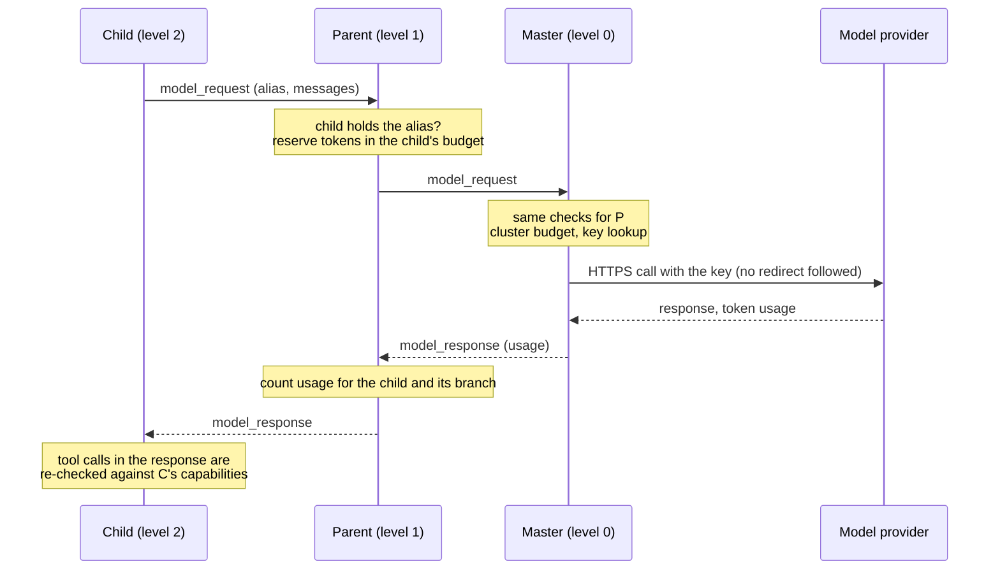

# Talixio Agent Network — design

This document describes how Talixio Agent Network is built and why: its architecture, its security
model, the decisions behind it, the independent security reviews it has been through, and what is
known to be missing. It is written for contributors, security reviewers and evaluators. Decision
numbers ("Decision 17") are stable identifiers; gaps in the numbering are decisions that only
concern internal process.

## 1. Purpose and scope

Talixio Agent Network runs autonomous AI agents as a tree of small processes. Each agent is one
`talixio-agent` process with a model, instructions, a set of capabilities and the tools those
capabilities allow. An agent that holds the right to do so creates child agents, on its own machine
or elsewhere, and gives each a mission: an objective and a measurable success criterion. The agent
at the top of the tree, the master, holds the model keys and serves the HTTP API and the web
interface. Typical uses are a security audit agent deployed on a virtual machine that reports to a
parent, which then sends a second agent with different rights to fix what was found.

The engineering is deliberately plain: one executable, TOML configuration, SQLite, TLS. The design
effort goes into containment. Everything is denied by default, a child never holds more than its
parent, and every tool call is checked again by the process that executes it, whatever the model
asked for.

It is not an operating-system sandbox: agents under one account are separated by the program, not
yet by the kernel (section 9). It is not a framework or library for building agents, it has no
built-in web browsing tool, and it does not yet ask a human to approve sensitive actions. The
project is young; several modes have only been exercised by automated tests.

## 2. Architecture

### 2.1 One executable

The same static executable is the master, every child and the command-line client (Decision 1).
It embeds SQLite, the TLS stack, the web interface, the provider catalogue and the release notes.

| Command | Purpose |
|---|---|
| `talixio-agent root --config talixio.toml` | Runs the master (level 0). |
| `talixio-agent child`, `mcp-bridge` | Hidden. A child agent, started only by a parent with its bootstrap on standard input; the tool bridge of section 2.7. |
| `talixio-agent check` | Loads a configuration exactly as the master does, packs included, without starting anything. |
| `talixio-agent tree` / `send` / `watch` / `stop` | Client commands that talk to the master's API. |
| `talixio-agent service install` / `uninstall` / `status` | Registers the master with the system's service manager. |
| `talixio-agent pack list` / `show` / `install` / `remove` / `verify` / `tui` / `keygen` / `publish` | Packs of commands and roles (section 4). |
| `talixio-agent catalog show` / `check`, `releases` | Prints the embedded provider catalogue or validates a candidate file; prints the release notes. |

### 2.2 The agent tree

A parent chooses its child's name, role, instructions, model, capabilities and deployment target
through the `spawn_agent` tool. A child talks only to its parent. Of everything a child writes,
only `ask_parent` and `finish_mission` reach the parent's conversation; the rest goes to the
journal, which flows up to the master (Decision 8). A mission without both an objective and a
success criterion is refused. An agent that stops without concluding is prompted again; a parent
cannot call `finish_mission` while one of its children is still working.

Tools are offered only when the matching capability exists (for example `run_command` requires
an exec rule, `spawn_agent` the spawn right); `memory_write` and `memory_read` are always there.

### 2.3 The parent–child link

The child always connects to the parent (Decision 2): a WebSocket at `/link` on the parent's
listener, over TLS 1.3. Frames are JSON, `{ "seq": n?, "msg": { "type": … } }`.

- **No certificate authority.** Each listening agent has a self-signed certificate; the child
  receives its parent's certificate fingerprint at launch and refuses any other peer (Decision 9).
- **Mutual authentication.** The parent creates one secret per child and passes it on the child's
  standard input, never on a command line or in the environment. It never travels on the link:
  on each connection (`hello`, `challenge`, `proof`, `welcome`, 10 s at most) both sides prove
  possession with HMAC-SHA256 over the role, both nonces, the agent identifier and the parent's
  certificate fingerprint, so a proof is valid only on that TLS connection (Decision 3).
- **Sealed configuration.** In clear, a child receives only what it needs to reach its parent.
  Everything else (name, role, instructions, model, capabilities, limits) is one
  ChaCha20-Poly1305 envelope under a fresh per-child key, bound to the child identifier and the
  parent's certificate and address. The key is handed over once, on the authenticated link
  (Decision 23).
- **Reliability.** Messages carrying `seq` are acknowledged, resent after a reconnection and
  de-duplicated. When the link drops the child suspends; if the parent does not return within
  `die_after_secs` it shuts down with its descendants. There is never an orphan agent.
- **Bounds.** Eight unauthenticated handshakes at a time; a request with an `Origin` header (a
  browser) is refused; frames are limited to 16 MiB for model and service calls, 1 MiB otherwise;
  reports are bounded in number and size. Nothing is journaled before authentication.

### 2.4 Deployment targets

| Target | How the child is started | Bounds |
|---|---|---|
| `local` | A process on the parent's machine, with a cleaned environment. | The parent's own capabilities. |
| `kind = "ssh"` | The executable and the bootstrap are sent on the standard input of `ssh`; removed from the host when the child or the master stops. | Known host required (no trust on first use), no agent or port forwarding, `ssh` run with `-F /dev/null`; remote directory owned by the account, mode 0700. |
| `kind = "docker"` | A disposable container. | See container hardening in section 3.9. |

Outside the master's machine, the target sets the limit (Decision 17): each `[targets.<name>]`
carries a capability ceiling written by the operator. A deployed child never receives more than
that ceiling and verifies it again on arrival against the real paths of its machine. Only the
master deploys to a target; descendants of a deployed agent are created on that agent's machine.
The deployment executable is fully static (`x86_64-unknown-linux-musl`), so the target's
distribution does not matter (Decision 21).

### 2.5 State on disk

Everything lives under `state_dir` (mode 0700), which no agent tool can reach.

| Path | Content |
|---|---|
| `talixio.db` | The master's SQLite database: memory notes, journal (last 200 000 events), role directory, permanent agents, scheduled tasks. |
| `agents/<id>.db` | A child's database: its memory notes and embedding vectors. |
| `api-token`, `tls-fingerprint` | The API token (unless `TALIXIO_API_TOKEN` is set) and the master certificate's fingerprint, read by the CLI. |
| `keys/<provider>.key` | Keys entered through the UI, readable by the master's account only. |
| `connections.json` | Providers connected and models activated from the UI, and the master's chosen model. No secret. |

An agent's memory is re-read into its prompt at start; the beginning of a conversation then never
changes, so that provider-side prompt caching stays effective (Decision 16). Child log files are
rotated at `log_max_bytes`, a limit set by the master and carried in the sealed configuration.

### 2.6 The web interface

A React application built with shadcn/ui, compiled ahead of time and embedded in the executable;
`cargo build` does not need Node (Decision 22). It is served without a token because it contains
no data, and uses only the JSON API with a token entered by the user. It shows the live tree, the
dialogue with the master, the journal, commands, providers and models, roles and scheduled tasks.

### 2.7 The model gateway

Model keys exist only at the master (Decision 4). A child asks for a model by alias; each parent
on the way checks that the child holds the alias and has budget left, reserves the cost, and
relays upward. Only the master calls the provider.

- **Token budgets** (`capabilities.max_tokens`) cover an agent and all its descendants. Each call
  reserves its share before leaving, and the master's budget applies to the whole tree.
  Consumption is counted by the parent, never taken from what the child declares.
- **Service models** (Decision 25) have a `nature`: `transcription`, `speech`, `image`,
  `embedding`, `forecast`, `decision` (`llm` is the default; `vision = true` marks a text model
  that reads images). They go up the same way (`service_request`) and are counted in calls per
  nature (`capabilities.max_calls`); an absent nature means zero calls. A call that left for the
  provider is counted whether or not it succeeded, and is never retried. Inputs and outputs are
  bounded and checked (a returned image must be PNG, JPEG or WebP).
- **Provider errors stay in the master's journal**; children receive a neutral message
  (Decision 13). The master follows no redirect from any provider. Connectors: `anthropic`,
  `openai` (any OpenAI-compatible server), `elevenlabs`, `timesfm`, `systemone`, `claude-code`.

**Provider catalogue.** The executable embeds `catalog.toml` (providers with country and trust
level, models with nature and indicative prices), served by `GET /api/models`; `catalog_file`
replaces it. A provider is connected and a model activated from the UI at run time (Decision 26):
the key is sent only to the address the catalogue gives for that provider, tried first, then
stored under `keys/`. No route returns a key. Activation gives the model an alias and adds it to
the master's capabilities. Deactivating or disconnecting touches only what was done from the UI
and is refused while a live agent holds the model. OAuth (PKCE S256) is used where a provider
offers it without prior app registration. `model` and `[models]` are optional in the
configuration: without them the master starts with no model and no key and receives its model
from the UI; a `model` written in the configuration cannot be changed from the UI (Decision 31).

**Claude subscription** (Decision 32). The `claude-code` connector runs the official `claude`
command, unmodified, under the master's account; `claude` performs its own authentication. The
master never reads, stores or forwards a subscription token and never calls the API with one.
`claude` is started with its built-in tools, settings and extensions disabled and a reduced
environment (`ANTHROPIC_API_KEY` always removed). It sees only the agent's tools, served by
`talixio-agent mcp-bridge`, which calls back `POST /bridge` with a per-turn token. A tool call is
held and returned to the agent, which executes it under its own capabilities. The master reads
what `claude` announces and kills the turn if it holds or calls anything other than the agent's
tools. `claude` is an optional external program, like `ssh` and `docker`.

## 3. Security model

### 3.1 Threat model

Defended against:

- **A misbehaving agent**, whether its model is mistaken or manipulated by text it reads: it must
  not leave its capabilities, manipulate its parent, pose as another agent, or exhaust resources.
- **Another local process or account**: it must not read secrets, pass for a parent or a child,
  or drive the master.
- **The network** between agents and between operator and master, and **the host of a pack
  repository**, which is not trusted for integrity.

Not defended against, or only partly:

- **A granted command misusing the account's rights.** Capabilities are enforced by the process,
  not by the kernel: a permitted program runs with all the rights of the agent's account.
- **Semantic prompt injection.** Tagging prevents a message from impersonating another speaker,
  not a model from being persuaded. Minimal capabilities and budgets limit the damage; human
  approval of sensitive actions is not implemented.
- **Compromise of the master's account.** It holds the model keys, the ssh key of its targets
  and, where configured, access to Docker, which is equivalent to root on that machine.
- **A replaced or subverted agent process.** What bounds it is what its parent checks itself
  (models, budgets, tree size, messages) and the account it runs under.
- **The holder of the API token** is the operator: the token can stop agents, connect a provider
  and so commit spending. It cannot read a key.

### 3.2 Deny-by-default capabilities

An agent can do only what `[capabilities]` lists.

| Capability | Meaning |
|---|---|
| `fs_read`, `fs_write` | Directories. Resolved to their real path once, when granted; a symbolic link can neither widen a grant nor redirect a write. Files are opened without following links and re-verified once open; writing to a file with several hard links is refused (Decision 11). |
| `[[capabilities.exec]]` | A closed list of commands, run without a shell. `program` is an absolute path outside any writable directory; `args` is matched position by position; `cwd` is fixed. |
| `models` | Model aliases the agent may request. |
| `max_tokens`, `[capabilities.max_calls]` | Token budget, and calls per service nature, descendants included. |
| `[capabilities.spawn]` | `max_children` (live direct children), `max_depth` (levels below), `targets` (default `local`). |

Argument patterns in an exec rule: a literal matches that exact argument; `"*"` is one free
argument that is never an option (nothing starting with `-`); `"{read}"` and `"{write}"` are paths
checked against the agent's read or write directories; `"**"`, last, is a run of free arguments
without options. Agents are shown these slots as `<read-path>`, `<write-path>`, `<arg>` and
`<args...>` (a model copies braces and stars as they stand), and a refused command is answered
with the allowed forms and a worked example. Every process started by an agent gets a cleaned environment (Decision 6), bounded
output (64 KiB per stream) and a process group (a Job Object on Windows) that is killed when the
command ends, times out, or the agent stops.

Always forbidden to tools, whatever is granted: the state directory, declared key files, the
packs directory, the account's `.ssh` directory, `~/.claude`, `~/.claude.json` and
`CLAUDE_CONFIG_DIR`, and the Docker socket. Forbidden paths are inherited by local children.

### 3.3 Attenuation

`check_grant` in `policy.rs` refuses any capability the parent does not itself hold: read and
write directories must lie inside the parent's, exec rules must be the parent's, models and call
quotas cannot exceed the parent's, the child's `max_depth` is strictly smaller and its
`max_children` no greater, and deployment targets are a subset (Decision 5). The child's model
and target are fixed by the parent. A child has one conversation model; `spawn_agent` can add
only service models or `vision`. On a deployment target the ceiling of the target applies on top.

### 3.4 Re-verification

Every tool call is checked by the executing process against its own capabilities; the model's
output is never trusted. Every model and service request is re-checked at each level it crosses
(alias still held, request bounds, quota). What a child declares is not believed (Decision 7):
the identity, capabilities and consumption shown for it are those its parent knows. The subtree a
child reports is bounded (2000 agents, 32 levels) and sanitised, a child cannot claim an agent of
another branch, and a declaration inconsistent with what the parent could grant is flagged
`unverified`. Each message enters an agent's conversation inside a tag carrying a random secret
marker specific to that agent, so content cannot pose as another speaker (Decision 12).

### 3.5 The master cannot grant itself powers

The master has no tool and no API route that installs a command or a role, edits its
configuration, or creates a scheduled task. New commands and roles arrive only as packs installed
by the operator from the command line (Decision 37).

- At start the master reads `packs_dir` and **refuses to start** if that directory, any file in
  it, or any directory above it up to the root is owned by or writable by its own account (unless
  mounted read-only), or if a file no longer matches the SHA-256 recorded in `pack.lock` at
  installation. `packs_unprotected = true` disables the ownership check for trials.
- A pack's identifier is the SHA-256 of its whole content. `[packs]` in the configuration can pin
  each pack to an identifier; the master then starts only with exactly those packs.
- A pack command's rule carries the hash of its program (`sha256`). The hash follows the rule from
  parent to child without passing through the model and cannot be dropped on the way; the agent
  that runs the command re-reads the program and refuses if it changed. A hand-written rule on a
  pack program is refused at load.
- **Dedicated account** (Decision 38, Linux with systemd). `sudo talixio-agent service install`
  creates the system account `talixio-agent` (no password, no shell, no home directory), places
  the executable and packs in `/opt/talixio` and the configuration in `/etc/talixio/talixio.toml`,
  all owned by root, and gives the account a single directory, `/var/lib/talixio`. The
  configuration is first tested under the account with `talixio-agent check`. Changing the
  configuration or the packs then requires root and a service restart.
- **systemd hardening.** All units set `NoNewPrivileges=true`, `UMask=0077` and `LimitCORE=0`.
  System units add an empty `CapabilityBoundingSet` and `ProtectKernelTunables`,
  `ProtectKernelModules`, `ProtectControlGroups`, `ProtectClock`, `ProtectHostname`,
  `RestrictSUIDSGID`; the dedicated-account unit adds `ProtectSystem=full` and
  `ReadOnlyPaths=/opt/talixio /etc/talixio`. The master never runs as root.

### 3.6 Signed pack repository

A repository is a directory of static files (Decision 40): `index.toml` (for each pack its name,
version, description, identifier, and for each file its name, size and SHA-256), `index.toml.sig`
(an Ed25519 signature over the index with a domain-separation prefix) and
`<name>/<version>/<file>`.

- The index signature is verified before the index is parsed, against the keys built into the
  executable (`TRUSTED_KEYS`, currently empty) and those the operator supplies (`--key`,
  `TALIXIO_PACK_KEY`). Without a trusted key or a valid signature, nothing is read. `http://` is
  refused; weak-order public keys are refused.
- Each downloaded file is checked against the signed index and the rebuilt pack against its
  identifier. No redirect is followed. Integrity does not depend on HTTPS.
- `--depot` requires a signature; `--from` reads a local directory as is and says it is unsigned.
  The option decides the nature of the source, never the content found there.
- **Rollback protection.** The index date is displayed; an index dated in the future is refused;
  `pack.lock` records the signing key and index date a pack came from, and `install --replace`
  refuses an older index from the same key unless `--allow-older` is given.

### 3.7 API authentication and TLS

The API is served over HTTPS only (TLS 1.3). Every data route requires
`Authorization: Bearer <token>`, compared in constant time. The token comes from
`TALIXIO_API_TOKEN` (a weak value or the documentation's example value stops the start) or is
generated at first start in `<state_dir>/api-token`. The master generates its own certificate at
first start; the CLI pins its fingerprint (`<state_dir>/tls-fingerprint`, `--fingerprint`,
`TALIXIO_TLS_FINGERPRINT`) or validates a public certificate with `--public-cert`. Browsers do
not recognise the self-made certificate: the operator supplies one from a recognised authority
(`[tls]`, `cert_file`, `key_file`) or checks the fingerprint printed at start. The UI is served
under a strict Content-Security-Policy (no inline script or style, no external resource, no
framing); API responses carry `Cache-Control: no-store` and `nosniff`.

### 3.8 Text sanitisation

Text from agents, providers, packs or remote hosts is data. One `clean` function (`src/lib.rs`)
strips control characters, terminal escape sequences, invisible, bidirectional-override, tag and
private-use characters, and bounds the length. It is applied to journal events, reported trees
and declared capabilities, provider and ssh output, pack manifests (a pack containing such
characters is refused) and every CLI error. The pack TUI shows every character in one column and
replaces anything else with `?`. The UI inserts all text as text, never as HTML.

### 3.9 Container hardening

An agent container (Decision 19) is disposable and started with no Linux capability, no new
privileges, a read-only root filesystem, bounded memory and process count, state in memory, a
mandatory numeric non-root `user`, only the mounts the target lists, and an image that is never
pulled implicitly. The Docker socket is never mounted into an agent container; a target that tries
is refused at load. Optional per-target settings are `memory`, `seccomp` (path of a syscall
filter), `network`, `agent_in_image`, and mounts by `volume` with a mandatory `subpath`.

A master that itself runs in a container can start agents in sibling containers when explicitly
given the host's Docker socket (Decision 36). Whoever takes over that master process then controls
Docker and therefore the host; such a master should hold no exec rule with free arguments.

### 3.10 Secrets for commands

Some commands need a credential: a read-only token to clone a private repository, an API key
for a tool. The rule is the one that already holds for model keys: **a secret never reaches a
model**. It goes to one command, for one run.

- **Where they live.** In the master's vault, one closed file per secret under
  `<state_dir>/secrets/`, out of every agent's reach like the rest of the state. The operator
  manages them from the "Secrets" page or the API: add, replace the value, enable, disable,
  delete. The value is written once; no route returns it.
- **What may receive one.** Only a command of an installed pack that declares the variable it
  reads the secret from (`secrets = ["AUDIT_READ_TOKEN"]` in `pack.toml`), with the plain
  settings that go with it (`env`, for instance the address the token is valid for). A pack
  can only declare variables under its own name (`AUDIT_…`), never one the system, the shell or
  a tool gives a meaning to. A hand-written rule in the configuration cannot declare one.
- **Who may use it.** The operator ties each secret to one command, one variable and a list of
  installed roles (and, if wanted, the master itself). The right travels with the command's
  rule: only an installed role brings it to an agent, a request from a model never does, and a
  child holds at most what its parent's rule holds. A role name of the form `pack/role` can
  only be an installed role the creating agent holds.
- **The way.** When an agent runs such a command, its process makes a throwaway X25519 key
  pair and asks over the link. Every parent on the way checks that the child holds the command
  with that secret, and writes what it knows: the child's role, and whether it runs on another
  machine. The master looks the secret up (command, variable, role, enabled) and seals the
  answer for the asker's key (X25519, HKDF-SHA256, ChaCha20-Poly1305); the agents in between
  relay what they cannot read. The value is set in the environment of that one command, kept
  nowhere else, and removed from the command's output before the model reads it. The journal
  records the fact, by name: which secret went to which command of which agent.
- **Elsewhere.** A secret is refused to an agent on an ssh target, or below one, unless the
  operator allows it for that secret: there it exists in the memory of an account the master
  does not hold.
- **Disabling** takes effect at the next run, everywhere: no agent keeps a copy.

What this does not guarantee: the command that receives a secret can do anything with it,
which is why only pack commands, reviewed and out of the master's reach, qualify. Output
redaction sees the exact value, not a transformed one. A role is given by a parent agent:
every agent able to create a role a secret is tied to can obtain a run of that command with
the secret, though not the value itself. A secret is saved for the program as installed: if
the pack is replaced, it is withheld until the operator saves it again. Agents under one account are not confined from each
other by the system (section 9).

## 4. Packs: commands and roles

A pack is a directory: a manifest `pack.toml` (`name`, `version`, `description`, optional `guide`),
scripts and text files. `[[command]]` entries name a script of the pack (`program`) and its
permitted `args`, using the patterns of section 3.2; `[[role]]` entries give a `name`,
`description`, `instructions`, the `commands` the role uses and an advised `model` and `target`.
Manifest fields are single-line, bounded and free of control characters, or the pack is refused.

| Command | Effect |
|---|---|
| `pack list`, `pack show <name> [--file f]` | What is available and what a pack would grant: commands, roles, role instructions, files. |
| `pack install <name> [--replace] [--allow-older]` | Installs beside the destination, then moves into place at once; writes `pack.lock`. Effective at the master's next start. |
| `pack remove <name>` | Removes only the pack's own files. |
| `pack verify` | Lists installed packs with their identifiers and checks hashes, as the master does at start. |
| `pack tui` | Full-screen browser over the same operations and checks: `i` install, `r` remove, `v` verify, `q` quit, each change confirmed explicitly. It shows whether the source is signed and how much of a pack's text has been read. |
| `pack keygen --out <file>`, `pack publish --from <packs> --out <dir> --key-file <file>` | For publishers: create a signing key (private part in a 0600 file) and write a signed repository. |

Sources: the packs embedded in the executable (currently `catalogue` and `audit`), a local directory
(`--from`, unsigned), or a signed repository (`--depot` with `--key`). Destination: `--dir`,
`TALIXIO_PACKS`, or `/opt/talixio/packs` as root with the dedicated account. An installed role is
named `pack/role`: `spawn_agent` with that name gives the child the role's instructions and
commands, while directories, budget and mission remain the master's choice within its own
capabilities. Installed roles are visible, read-only, through `GET /api/roles` (Decision 39).

**The `audit` pack.** Audits git repositories from outside and writes a report; it never
changes or runs the repository. Commands: `fetch-repo` (read-only https clone: no hook, no
submodule, no LFS; the git data is kept outside every directory agents can write, so a
tampered clone cannot make git run anything), `repo-map` (reproducible numbers about the repository),
`repo-git` (nine fixed read-only questions: `files`, `search`, `history`, `recent`, `commit`,
`show`, `diff`, `blame`, `authors`), `new-report` (one file for each part of the report, each
with one writer), `build-report` (assembles the parts into `report.md` and a self-contained
`report.html`; the headings come from the command) and `check-report` (resolves every file, line
and commit a report cites and prints the cited line; it does not judge). Roles: one `lead` per repository, which
creates `goal`, `code-reviewer`, `setup-reviewer`, `planner`, an `editor` that consolidates
(summary, gaps, contradictions between parts) and a read-only `verifier` that tries to refuse
the report. The parts on disk are the shared memory between agents. The pack
derives from Talixio AI Claude Auditor. A private repository is read with a token the operator
adds as a secret for `fetch-repo` (section 3.10), with the address prefix it is valid for; the
command offers it to no other address. First runs with a real model (an open-weight model of
middle size) showed reports whose citations existed but pointed at the wrong line: hence
`check-report`, and a clone kept apart from the one directory agents write in. The pack needs `git`, `bash` and `python3` where the agents run (`examples/audit` has an image).

**The `notify` pack.** Sends work out of the cluster. `send-mail <file> [subject]` sends one
file as an attachment (10 MiB at most) over an encrypted SMTP connection only;
`send-webhook <text file> [title]` posts the start of a text to an incoming webhook (Slack,
Discord, Teams, or an https address that takes JSON). One role, `sender`. The split is the
point: an agent chooses the file, among those it may read, and a subject; the operator chooses
everything else, once, as a secret with settings beside it (section 3.10): the mail account,
the sender, the recipients, the webhook address and its kind. Nothing in a request, a file or
a report changes where things go; the commands follow no redirection and use no proxy. The
accepted risk is stated in the pack's guide: an agent holding these commands can send any file
it reads to those recipients, so the role goes only to agents that read nothing the recipients
may not see. Tried against local fake servers only, so far.

## 5. Operating modes

**Service** (Decision 28). `talixio-agent service install` writes the service definition and
starts it; `--print` shows what would be done. On Linux: a systemd user unit when run as an
ordinary user; as root with `--user <account>`, a system unit under that account, after checking
that the executable, the configuration and all their parent directories are owned by root or the
account and closed to others; as root without `--user`, the dedicated account of section 3.5. On
macOS: a per-user launchd agent. On Windows: a scheduled task at logon, without elevation or
restart after failure. No secret is written into a definition.

**Docker.** `Dockerfile` builds a `FROM scratch` image holding only the static executable and a
default configuration (`docker/talixio.toml`). The master runs as uid 65532; `/data/work` is the
only directory open to agents and no command is granted (Decision 29). `docker/Dockerfile.claude`
adds what the `claude` command needs. `docker/Dockerfile.navigateur` builds an agent image with
only Chromium and its driver, used through a `docker` target with `docker/chromium-seccomp.json`,
so that a browser runs in the agent's disposable container, never beside the master (Decision
35). `tools.sh` wraps building and running these images, and installs packs into a host directory
that the master receives mounted read-only.

**Scheduled tasks** (Decision 33). An instruction written in advance by the operator, delivered to
the master at fixed times (`hours`, `daily`, `weekly`) as an ordinary message; it grants nothing.
Tasks are managed only through the API; no agent tool can touch them. At most 32.

**Permanent agents** (Decision 30). `spawn_agent` accepts `permanent: true`, at the master only.
The master stores the creation request and replays it at each start through the ordinary creation
path, so every check is made again. A local permanent agent keeps its identifier and its memory;
its conversation is not restored. Ordinary agents do not survive a master restart.

**Releases** (Decision 27). Each version tag builds executables for Linux (x86_64 and ARM,
static), macOS and Windows, published with `SHA256SUMS` and install scripts that verify the
checksum. The checksum is published alongside the executable; releases are not signed.

## 6. HTTP API

Served by the master only, on `listen`, over HTTPS. Routes marked "no token" are public; all
others require `Authorization: Bearer <token>`. This API is what the web interface and the CLI
use. **It is not yet a stable interface**: paths and payloads may change between versions.

| Method | Path | Purpose |
|---|---|---|
| GET | `/link` | WebSocket endpoint for child agents (link authentication, not the API token). Present on every listening agent. |
| POST | `/bridge` | Callback of the `claude` tool bridge; per-turn token; can only submit that turn's tool calls. |
| GET | `/`, `/app.js`, `/app.css`, `/sans.woff2`, `/mono.woff2`, `/icon.svg`, `/manifest.webmanifest` | The embedded web interface (no token). |
| GET | `/api/health` | Liveness (no token). |
| GET | `/api/tree` | The tree: each agent's name, role, state, host, OS, IP, capabilities, tokens and service calls used, children. |
| GET | `/api/activity` | Journal events after a given event (`after`, `limit`). |
| GET | `/api/events` | The journal as a Server-Sent Events stream (`after`). |
| POST | `/api/messages` | Sends a message to the master (`text`). |
| POST | `/api/agents/{id}/stop` | Stops an agent and its descendants. |
| GET | `/api/releases` | Running version and release notes. |
| GET | `/api/models` | The master's models, its default model, and the catalogue of providers and models with their connection and activation state. Never a key. |
| POST | `/api/providers/{id}/connect` | Tries a key (`key`) at the catalogue's address for the provider, then stores it. |
| POST | `/api/providers/{id}/disconnect` | Removes models activated from the UI and deletes the key; refused while an agent holds one. |
| POST | `/api/providers/{id}/oauth` | Starts a browser authorisation (`callback`); returns a URL. |
| POST | `/api/providers/{id}/oauth/finish` | Exchanges the code (`code`) for a key that only the master sees. |
| POST | `/api/models/activate` | Activates a model of a connected provider (`provider`, `model`, optional `alias`, `calls`). |
| POST | `/api/models/{alias}/deactivate` | Deactivates a model activated from the UI; refused while an agent holds it. |
| POST | `/api/models/{alias}/default` | Makes this model the master's own; refused if the configuration fixes `model`. |
| GET | `/api/roles` | The role directory (agents created, at most 500 entries) and installed pack roles. |
| GET, POST | `/api/tasks` | Lists scheduled tasks; creates one. |
| POST | `/api/tasks/{id}`, `/api/tasks/{id}/delete`, `/api/tasks/{id}/run` | Updates or deletes a task, or delivers its instruction to the master now. |
| GET, POST | `/api/secrets` | Lists the secrets (never their values) and the commands that accept one; adds a secret. |
| POST | `/api/secrets/{name}`, `/api/secrets/{name}/delete` | Changes a secret (value, roles, settings, enabled) or deletes it. |

## 7. Design decisions

| No. | Decision | Rationale |
|---|---|---|
| 1 | One executable for master, children and CLI. | Nothing else to deploy or remove on a target. |
| 2, 3 | The child connects to the parent; per-child secret on standard input, proven by HMAC challenge-response in both directions. | The parent never needs to reach a child; the secret is never on a command line or on the wire, and a false parent learns nothing. |
| 4 | Model keys never leave the master. | A compromised child or target holds no key; all spending is counted on one path. |
| 5, 6 | Capabilities attenuate; the parent fixes the child's model and target; every started process gets a cleaned environment. | No sequence of spawns can widen rights. |
| 7, 8 | A child's declarations are not believed; only `ask_parent` and `finish_mission` reach the parent's conversation. | What a child says is data for its parent, never an order. |
| 9 | TLS 1.3 everywhere with self-made certificates and fingerprint pinning; the proof of the shared secret includes the fingerprint. | Encryption and authentication without operating a certificate authority; no eavesdropping or relay. |
| 11, 12 | Granted directories are real paths, files are opened without following links; each message is wrapped in a tag with a per-agent random marker. | Links cannot widen a grant; content cannot impersonate another speaker. |
| 14, 16 | Embedded SQLite, one database per agent, reachable only through memory tools; the start of a conversation never changes. | Durable memory without an external service; provider prompt caching stays effective. |
| 17–19 | Off-machine, the target's ceiling bounds capabilities and only the master deploys; ssh is non-interactive with known hosts only; containers are disposable and closed. | The operator, not a model, decides what a remote machine exposes; no trust on first use. |
| 21 | Static deployment executable (musl). | No dependency on the target's distribution; cost: slower allocator, no NSS name resolution. |
| 22 | React/shadcn UI, built output committed and embedded, strict CSP. | Building the executable needs no Node toolchain; the page holds no secret. |
| 23 | Sealed child configuration. | A child never starts with anything other than what its parent wrote, in transit or at rest. |
| 25 | Service models go through the master, counted in calls per nature. | Keys stay at the master; a duration or size cannot be measured reliably before a call, a call count can. |
| 26 | Providers and models are connected from the UI at run time; keys go only to catalogue addresses. | No restart or file edit for routine operation; the page never chooses where a key is sent. |
| 30, 33 | Permanent agents are re-created by replaying the creation request; scheduled tasks are operator instructions managed only through the API. | Nothing is restored without passing every current check; agents cannot schedule themselves. |
| 28, 31 | The master installs as a system service and never runs as root; it receives its model like any other agent. | A master can start with no key and be configured from the UI; the configuration keeps the last word. |
| 32 | Claude subscription only through the official `claude` command. | Subscription credentials are handled by the vendor's own program, never by this one. |
| 35, 36 | A browser lives in the agent's container, never beside the master; a containerised master may start sibling containers through the Docker socket, on explicit option. | Page scripts run in a disposable container; isolated contexts without Docker-in-Docker, at the cost stated in section 3.9. |
| 37–39 | Packs are installed by the operator, never by the master; hashes verified at start and at each call; installed roles are shown read-only; with the dedicated account, everything the master reads is owned by root. | The master cannot extend its own powers, and file ownership enforces it. |
| 40, 41 | Signed static pack repository; `pack tui` is only a front end to the `pack` commands. | Distribution without server-side code and without trusting the host. |

## 8. Security reviews

Every new surface (tool, link message, API route, deployment mode) goes through a dedicated
security review by a reviewer independent of the author of the change, by reading and, where
possible, by reproducing attacks. Sixteen passes have been made so far. Confirmed findings are
fixed and, where practical, replayed as tests (`tests/security.rs` and others). Severities are the
reviewer's.

| Pass | Surface | Findings | Outcome |
|---|---|---|---|
| 1 | Whole code base: capabilities, link, isolation | 17: 1 critical, 6 high, 7 medium, 3 low | All fixed; 2 items open |
| 2 | ssh and Docker deployment, TLS | 10: 2 high, 3 medium, 5 low | All fixed; 2 clean-up gaps open |
| 3 | Web UI, `/api/models`, `/api/roles`, role directory | 10: 1 high, 3 medium, 6 low | All fixed |
| 4 | Service models and image reading | 9: 1 high, 1 medium, 6 low, 1 info | 8 fixed, 1 partly |
| 5 | Provider connection from the UI, key storage, OAuth | 8: 2 medium, 4 low, 2 info | 6 fixed, 1 partly, 1 accepted |
| 6 | Service installation, Docker image, release and install scripts | 8: 3 medium, 5 low | 5 fixed, 3 partly |
| 7 | Master's model set from the UI | 6: 1 medium, 2 medium-low, 3 low | All fixed |
| 8 | Claude subscription connector, bridge, `/bridge` | 12: 1 medium-high, 3 medium, 2 medium-low, 6 low | 11 fixed, 1 noted as a limit |
| 9 | Scheduled tasks, `make_dir`, `list_provider_models`, `catalog check`, example scripts | 14: 3 medium, 8 low, 3 info | 11 fixed, 3 noted as limits |
| 10 | Agent browser script, image and syscall filter | 11: 2 high, 4 medium, 4 low, 1 info | 9 fixed (1 partly), 2 noted as limits |
| 11 | Containerised master and sibling containers | 7: 2 medium, 4 low, 1 info | 4 fixed, 1 accepted, 2 noted |
| 12 | Packs | 14: 1 high, 4 medium, 1 low-medium, 7 low, 1 info | 12 fixed, 2 noted as limits |
| 13 | Dedicated account installation | 12: 1 high, 3 medium, 5 low, 3 info | 10 fixed, 2 noted |
| 14 | Signed pack repository | 12: 1 high, 3 medium, 7 low, 1 info | 11 fixed, 1 noted |
| 15 | Pack TUI | 12: 2 high, 4 medium, 6 low | Fixed except 2 noted items |
| 16 | `audit` pack: `fetch-repo`, `repo-git`, `repo-map`, `new-report` | 9: 2 critical, 1 high, 2 medium, 3 low, 1 info | 8 fixed, 1 partly (no clone size quota) |
| 17 | Secrets for commands: vault, link messages, API, redaction | 9: 2 medium, 5 low, 2 info | 8 fixed, 1 noted (environment of a running command readable by same-account agents) |
| 18 | `check-report` (audit pack) and the refusal messages shown to agents | 9: 2 medium, 6 low, 1 info | 9 fixed |
| 19 | `build-report` (audit pack): parts assembled into Markdown and a standalone HTML page | 7: 1 medium, 5 low, 1 info | 6 fixed, 1 noted |

Findings knowingly left open:

- **Accepted risks.** A containerised master given the Docker socket passes that access to
  everything it starts (pass 11). OAuth relies on PKCE alone, without a `state` parameter (pass
  5). Four routes read the request body (2 MB at most) before checking the token (pass 5). The
  `local` provider is a port any local process could occupy; it is never made the master's model
  automatically (passes 5, 7).
- **Link.** A peer that drips a frame slowly to appear alive is not detected; link and API share
  one listener (pass 1). The handshake carries no version (pass 11).
- **Deployment clean-up.** The remote log of a child that dies at start is not retrieved;
  databases of grandchildren created on a target are not removed (pass 2).
- **Accounting.** Tokens of a failed or abandoned `claude` turn are not counted (pass 8).
- **Packs.** Files next to a pack script are re-verified only at master start (pass 12). A
  repository host can withhold an update or, at first installation, serve an older signed index;
  pinning identifiers in `[packs]` counters this. Keys are revoked only by a new executable.
  `pack publish --out` follows a link and is not atomic; as root, `pack install --from` reads the
  source by path (passes 13, 14).
- **Service and supply chain.** `PrivateTmp`, `ProtectHome` and `ProtectSystem=strict` are not
  evaluated on a real systemd (pass 13). Build actions and base images are referenced by tag, not
  digest (passes 6, 10).
- **Audit pack.** No quota on the total size of a clone (time, memory and single-file limits
  only). `fetch-repo` reaches any public-looking https host the agent names; a token is offered
  only to the address prefix the operator bound it to (pass 16).
- **Secrets.** While a command runs, its secret is in the environment of that process and of
  what it starts: an agent of the same account that can read `/proc` could read it there. A
  compromised agent process that may create agents can obtain what its own descendants could
  obtain. A docker target driving a remote daemon counts as local. Behind a proxy, commands
  cannot reach the network (their environment is emptied, proxy settings included) (pass 17).
- **Other.** Third-party scripts on a page read by the example browser script can send what they
  see to any public name (pass 10). A scheduled task survives a change of API token (pass 9).
  The pack TUI does not restore the terminal on SIGTERM or SIGHUP (pass 15).

## 9. Known limitations and open questions

**Isolation**

- Isolation between agents under one account is enforced by the program, not yet by the operating
  system. A granted command runs with all the rights of the agent's account and can read or write
  outside the granted directories. Until OS-level confinement exists (dedicated users, Landlock,
  seccomp), grant only narrowly written commands, never an interpreter, and run the master under
  the dedicated account or in a container. The gap between checking a path and opening it is
  narrowed, not closed.
- On an ssh target the ceiling is enforced by the agent itself; the real boundary is the remote
  account, which should be dedicated and unprivileged. The master's account holds the ssh key.
- An agent container keeps network access: it must reach the master, and can reach whatever else
  the host network allows. What an agent sends to a service model leaves the tree.
- Keys are stored in clear on the master's disk, readable by its account only; no encrypted vault.

**Not yet exercised in real conditions**

- ssh deployment on a real host (tested with a substitute `ssh`).
- The service under a real systemd, launchd or Windows, and a real Windows or macOS workstation
  (continuous integration builds and tests on all three systems).
- A pack repository served over HTTPS, and rootless Docker.
- Service models (speech, image, embeddings, forecast, decision) with a real provider.

**Functional gaps**

- No official pack repository yet: the signing key (`TRUSTED_KEYS` is empty) and the address are
  undecided. Available today: the embedded pack, local packs, and repositories whose publisher's
  public key the operator holds.
- A remote target must share the master's CPU architecture, and an ssh target must be POSIX.
- No human approval step for sensitive actions, and no conversation compaction: a long mission
  can outgrow the model's context window.
- Budgets are in tokens and calls, not money. An agent does not see its remaining budget, and the
  sum of budgets a parent hands out is not capped by what it has left.
- Ordinary agents and conversations are not restored after a master restart; agents cannot yet
  query the role directory.
- The web interface is available in English and French; server-side messages (journal entries,
  API errors, CLI output, release notes) are in French for now.

**Open questions**

- Who publishes the official pack repository and where its signing key is kept.
- Which OS confinement mechanism to adopt first, and whether a containerised master should move
  into a virtual machine rather than hold the Docker socket.
- An encrypted store for the master's keys, possibly under another account than the agents.
- A per-machine host agent that runs as a service and starts the other agents there.
